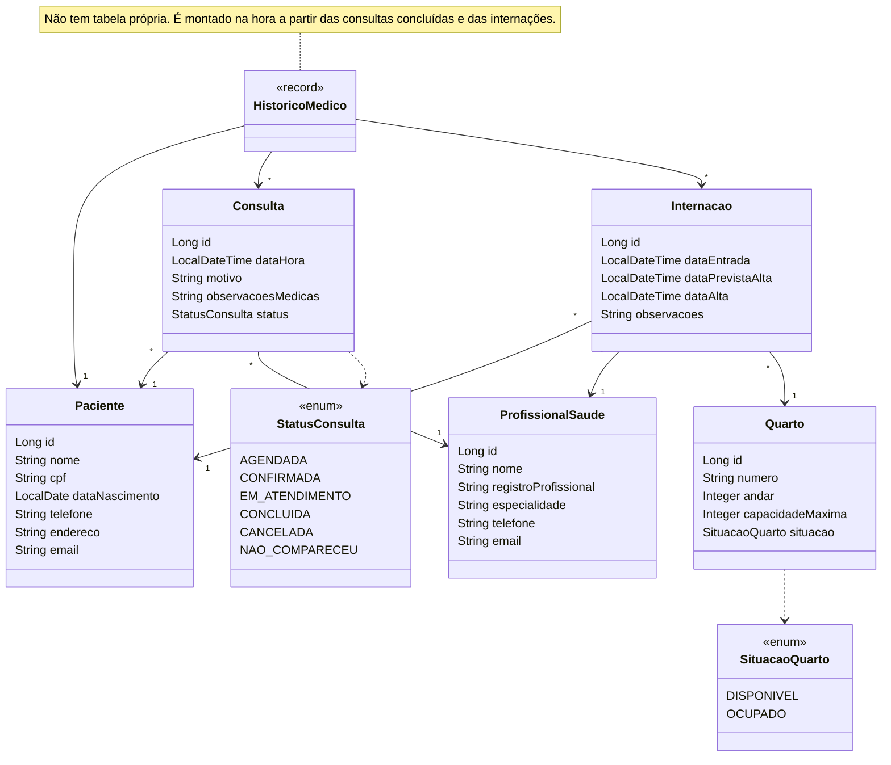

# Diagrama de classes do AuraMed

As classes do sistema e como elas se ligam.

**Cores:** 🟦 azul = pessoas · 🟩 verde = atendimentos · 🟨 amarelo = quarto · 🟪 roxo = listas de opções

**Lendo as setas:** `"*" --> "1"` quer dizer "muitos para um". Por exemplo, um paciente pode ter várias consultas, mas cada consulta é de um só paciente.

Versões para entrega: [PDF](Diagrama_Classes_AuraMed.pdf) e [SVG](Diagrama_Classes_AuraMed.svg).
