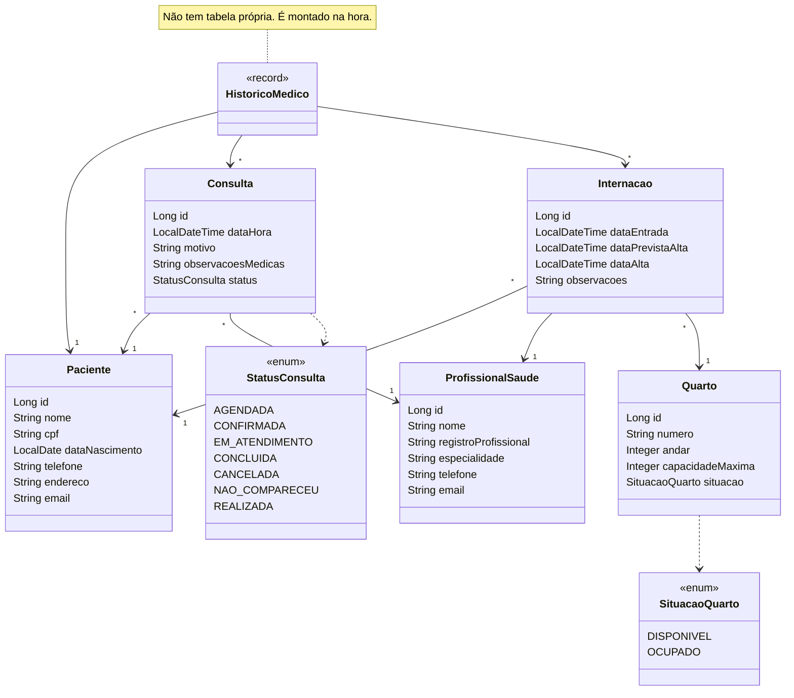

# Diagrama de classes do AuraMed

As classes do sistema e como elas se ligam.

**Cores:** verde = guardado no banco · azul = montado na hora · roxo = listas de opções

<!-- diagrama:inicio -->

<!-- diagrama:fim -->

**Lendo as setas:** `"*" --> "1"` quer dizer "muitos para um". Por exemplo, um paciente pode ter várias consultas, mas cada consulta é de um só paciente.

Este diagrama é gerado a partir do código. Depois de mudar uma classe em `model/`, rode `python3 scripts/gerar_diagrama_classes.py` na raiz do projeto.

Versões para entrega: [PDF](Diagrama_Classes_AuraMed.pdf) e [SVG](Diagrama_Classes_AuraMed.svg).
