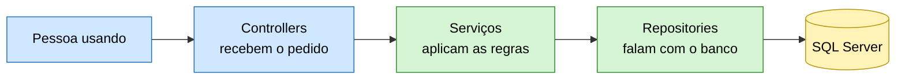
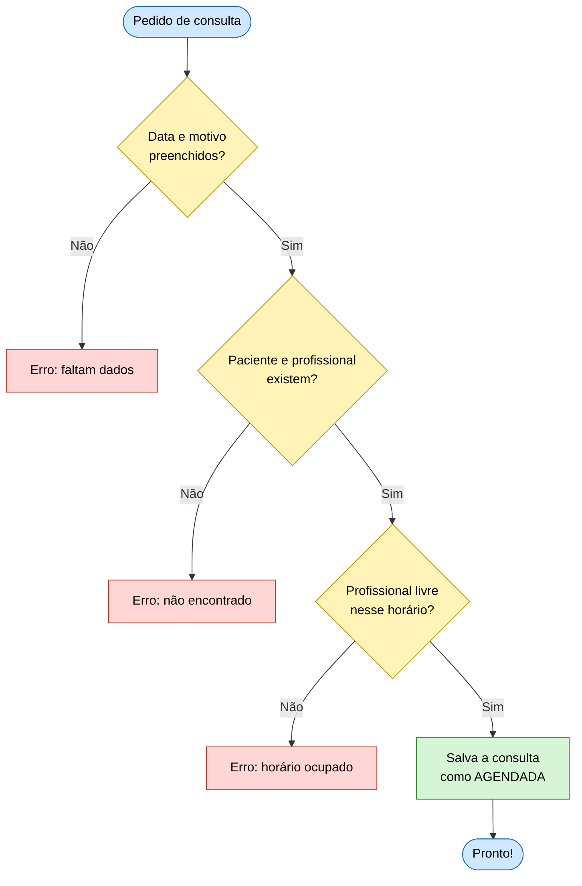
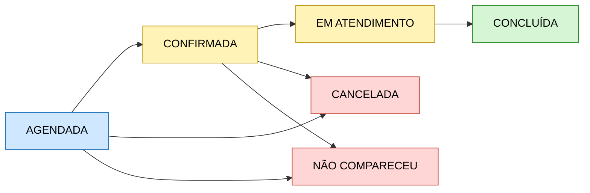
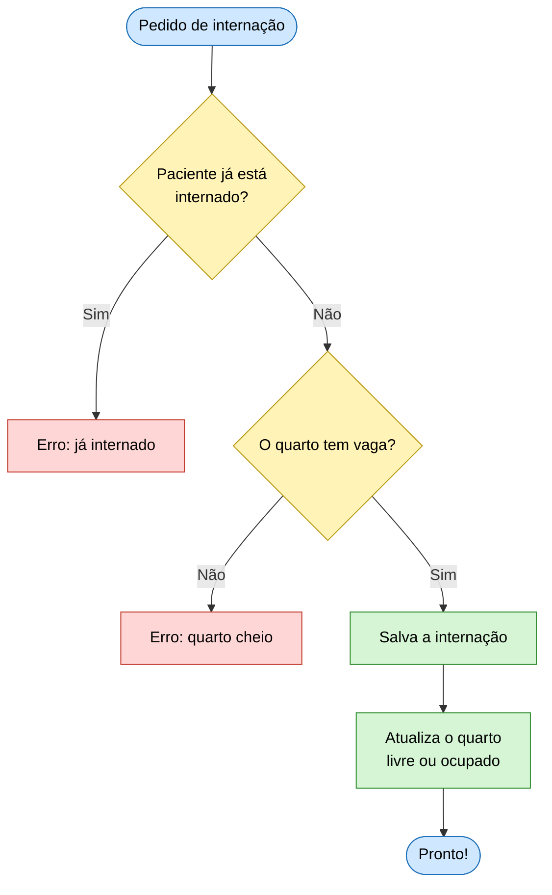
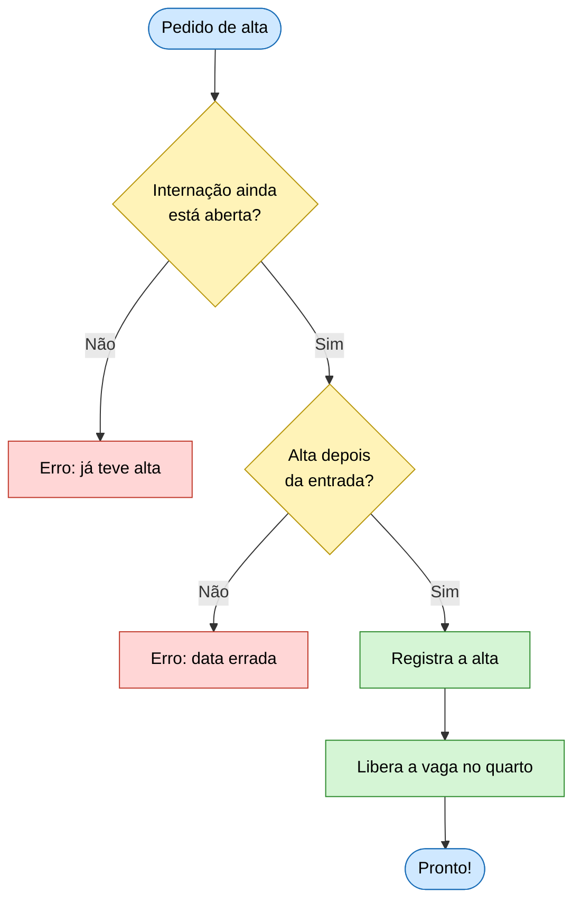
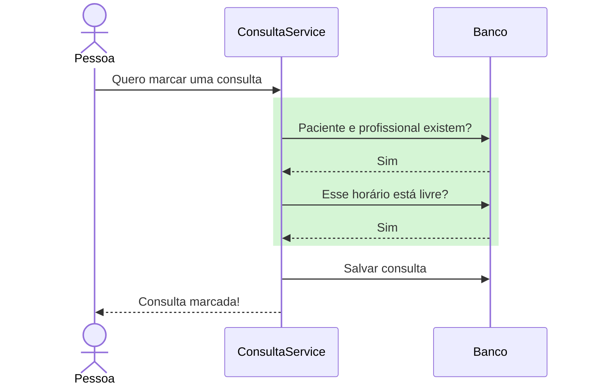

# Diagramas do AuraMed

Aqui estão os desenhos que explicam como o sistema funciona. O GitHub mostra todos direto na página.

Quer ver as classes? Veja o [diagrama de classes](Diagrama_Classes_AuraMed.md). As responsabilidades de cada uma estão nos [cartões CRC](Cartoes_CRC_AuraMed.md).

**Cores:** azul = telas e pessoas · verde = regras do sistema · amarelo = banco de dados e perguntas · vermelho = erro

## 1. Como o sistema é organizado

Quem usa o sistema fala com os controllers. Eles chamam os serviços, que seguem as regras e guardam tudo no banco.

## 2. Marcar uma consulta

## 3. Os passos de uma consulta

Uma consulta só anda para frente. Não dá para voltar atrás.

## 4. Internar um paciente

## 5. Dar alta

## 6. Conversa entre as partes (marcar consulta)

