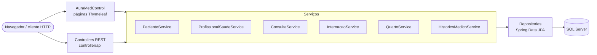
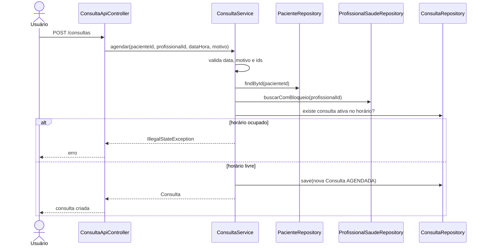
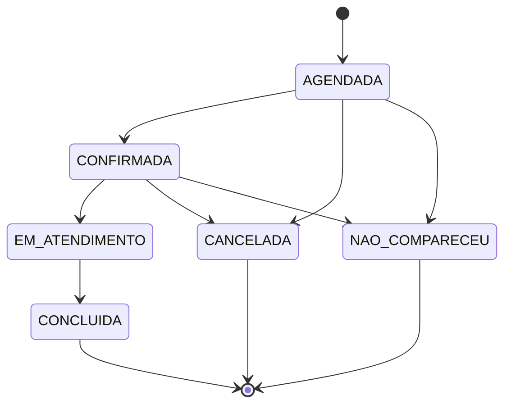
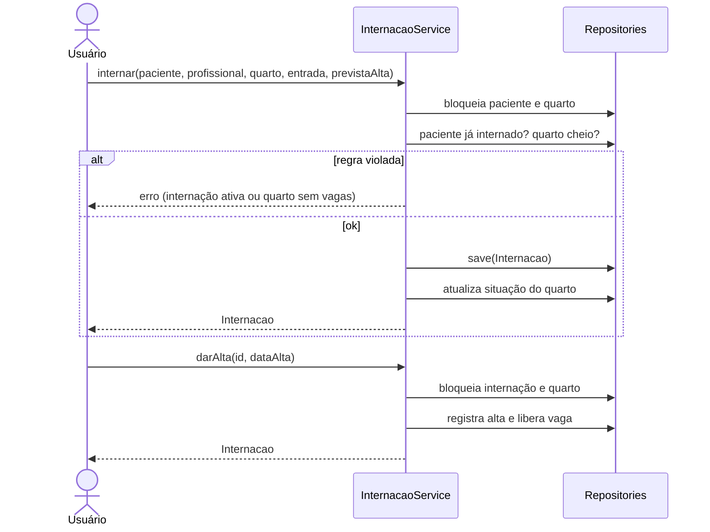

# Diagramas — AuraMed

Diagramas em Mermaid, renderizados direto no GitHub. O diagrama de classes completo (com PDF e SVG) está em [Diagrama_Classes_AuraMed.mmd](Diagrama_Classes_AuraMed.mmd).

## Arquitetura em camadas

## Agendamento de consulta

## Ciclo de vida da consulta

`REALIZADA` é um valor antigo, mantido por compatibilidade e tratado como `CONCLUIDA`.

## Internação e alta

